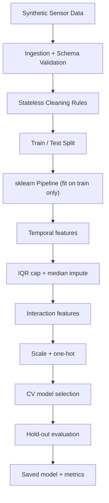

# AQI Sentinel

### Smart-City Air Quality Prediction | End-to-End Machine Learning Pipeline

**Turning noisy environmental sensor data into a validated, leakage-safe AQI prediction model.**

AQI Sentinel simulates multi-station environmental readings, deliberately corrupts them the way real sensors fail, cleans and validates the data, engineers physically motivated features, and trains and evaluates a regression model. The emphasis is on **data quality, leakage-safe preprocessing, modular architecture and reproducibility**, not on chasing a score.

**[View the live results dashboard](https://ojas-v.github.io/aqi-pipeline/)** (needs internet; Chart.js loads from a CDN)

---

## Results

Single reproducible run (`random_state=42`, 2,000 generated rows, 80/20 split, 5-fold CV on the training split).

| Metric (hold-out test set) | Value |
|:---|---:|
| **RMSE** | 6.26 AQI points |
| **MAE** | 4.49 AQI points |
| **R²** | 0.959 |
| Selected model | Gradient Boosting (lowest CV RMSE) |

| Candidate (5-fold CV, whole pipeline) | CV RMSE | CV R² |
|:---|---:|---:|
| Gradient Boosting | 7.38 | 0.951 |
| Random Forest | 7.82 | 0.945 |

**Cleaning effect (training split):** IQR capping plus median imputation reduces PM2.5 variance from roughly 4,700 to roughly 260, because injected sensor spikes dominate the raw variance.

**Feature importance:** about 81 % of the model's importance sits on `pm25_ugm3`, followed by `pm10_ugm3` (about 12 %) and the engineered `pm_fine_fraction` (about 4 %). This matches how the target is built (see [Limitations](#limitations-and-scientific-validity)): the high R² is expected by construction.

> Exact figures can differ in the last decimals across scikit-learn / pandas versions. The authoritative numbers for your machine are in `artifacts/metrics.json` after running `python main.py`.

---

## At a Glance

| Component | Details |
|:---|:---|
| **Domain** | Environmental data science, smart cities |
| **Task** | AQI regression (nowcast) |
| **Language** | Python 3.10+ |
| **ML framework** | scikit-learn (`Pipeline`, `ColumnTransformer`, `KFold`) |
| **Data engineering** | Schema validation, rule-based cleaning, IQR capping, imputation |
| **Evaluation** | K-fold cross-validation of the full pipeline; RMSE, MAE, R² |
| **Flow** | Generation → Ingestion → Cleaning → Training → Evaluation |

## Why This Project?

Real sensor data is never clean: readings go missing, loggers emit sentinel codes such as `-999`, spikes appear, and the label itself can be absent. AQI Sentinel treats those failures as the main problem and builds a pipeline that:

- **Simulates imperfect data** with physically motivated signals, then injects spikes, impossible values, sentinel codes, scattered NaNs and a contiguous sensor outage.
- **Validates input** through schema checks, dtype coercion and physical-bound rules.
- **Prevents leakage** by fitting every learned statistic (IQR fences, medians, scaler, encoder) on training data only.
- **Engineers domain features**: cyclical time terms, a temperature-humidity interaction, a PM2.5/PM10 ratio and a stagnation index.
- **Selects models honestly** by cross-validating the entire pipeline, preprocessing included.
- **Persists** the fitted pipeline and metrics for repeatable inference.

## The Pipeline



| Stage | Responsibility | Module |
|:---|:---|:---|
| 1. Generation | Physics-based data with injected faults and gaps → `raw_data.csv` | `data_generator.py` |
| 2. Ingestion | Load CSV, validate schema, coerce dtypes, translate I/O errors | `src/ingestion.py` |
| 3. Cleaning | Drop duplicates and unlabeled rows, mask impossible readings, report before/after statistics | `src/cleaning.py` |
| 4. Features | Cyclical time, interaction and ratio features, `ColumnTransformer` assembly | `src/features.py` |
| 5. Modeling | Candidate registry, K-fold CV, model selection, hold-out metrics, persistence | `src/modeling.py` |
| Orchestration | Runs stages 1–5 in order with centralized error handling | `main.py` |

## Project Structure

```
aqi-pipeline/
├── main.py                 # Pipeline orchestrator
├── data_generator.py       # Synthetic data generation (Phase 1)
├── requirements.txt
├── README.md
├── .gitignore
├── raw_data.csv            # Generated dataset
├── docs/
│   └── index.html          # Results dashboard (GitHub Pages)
└── src/
    ├── __init__.py
    ├── config.py           # Columns, physical bounds, hyper-parameters
    ├── ingestion.py        # DataIngestor
    ├── cleaning.py         # DataCleaner, IQRCapper, DistributionReporter
    ├── features.py         # Feature transformers + pipeline factory
    ├── modeling.py         # ModelFactory, ModelTrainer, ModelEvaluator
    ├── exceptions.py       # PipelineError hierarchy
    └── logger.py
```

`artifacts/` (`aqi_model.joblib`, `metrics.json`) is created when you run `main.py` and is git-ignored.

## Getting Started

```bash
git clone https://github.com/ojas-v/aqi-pipeline.git
cd aqi-pipeline

python -m venv .venv
# Windows PowerShell:  .\.venv\Scripts\Activate.ps1
# Linux / macOS:       source .venv/bin/activate

python -m pip install --upgrade pip
pip install -r requirements.txt
python main.py
```

`main.py` prints the stage log, the before/after descriptive-statistics table (mean, median, variance, IQR fences), the cross-validation comparison, the hold-out metrics and the top feature importances.

| Output | Purpose |
|:---|:---|
| `raw_data.csv` | Generated dirty dataset |
| `artifacts/aqi_model.joblib` | Entire fitted pipeline (preprocessing + model) |
| `artifacts/metrics.json` | Selected model, test metrics, run configuration |

**Inference example** (the saved object is a full pipeline, so raw columns go straight in):

```python
import joblib, pandas as pd

model = joblib.load("artifacts/aqi_model.joblib")
X = pd.read_csv("raw_data.csv", parse_dates=["timestamp"]).drop(columns=["aqi"]).head(5)
print(model.predict(X))
```

---

## Engineering Decisions (and Interview Answers)

| Decision | Why |
|:---|:---|
| Stateless rules run **before** the split; IQR fences, medians, scaler and encoder run **inside** the `Pipeline` | Anything that learns a statistic from data must see training data only, otherwise test information leaks into training. |
| Impossible values (humidity > 100 %, `-999`) become NaN; extreme but possible spikes are IQR-capped | Faults are missing information; spikes are real-valued but high-leverage. Different problems need different fixes. |
| Cap first, then impute | Median imputation is outlier-robust, and capping first keeps the order valid if the strategy is switched to mean. |
| Rows with a missing target are dropped, never imputed | Imputing labels fabricates ground truth. |
| Cross-validate the **whole** pipeline | Preprocessing is refitted inside every training fold, so CV scores are leakage-free. |
| Cyclical sin/cos for hour and day of year | 23:00 and 00:00 are neighbours; raw integers say they are 23 apart. |
| Custom features: T×RH interaction, PM2.5/PM10 ratio, stagnation index | Physically motivated; the ratio separates combustion sources (fine particles) from dust (coarse). |
| `StandardScaler` kept although trees do not need it | Lets linear / SVR / NN candidates be added to `ModelFactory` without touching the pipeline. |
| `OneHotEncoder(handle_unknown="ignore")` | An unseen station type at inference must not crash the service. |
| Custom exception hierarchy (`PipelineError`) | One `except` in `main.py` fails gracefully; specific errors stay catchable. |

## Limitations and Scientific Validity

A high score does not mean the model can predict future real-world air quality.

- **Synthetic data:** the model learns the simulator's rules. Performance on real monitoring data is unverified.
- **Circular target:** AQI is derived from PM2.5 and PM10, which are also input features. The high R² largely reflects the target formula, not generalizable predictive power.
- **Nowcast, not forecast:** predicting current AQI from current readings is different from predicting AQI hours or days ahead.
- **Validation scheme:** random `KFold` is used because rows are asynchronous multi-station readings. It does not establish forecasting performance; a forecasting variant needs chronological splits (`TimeSeriesSplit`) and lag features built without future information.
- **Generalization:** behavior across cities, seasons, sensor types and pollution regimes is untested.

These define the next stage of work; they are not capabilities the current code has demonstrated.

## Roadmap

- Unit tests for `DataIngestor`, `DataCleaner`, `IQRCapper` and the feature transformers (`pytest`).
- Hyper-parameter search with `RandomizedSearchCV` on the full pipeline.
- Benchmark `HistGradientBoostingRegressor` and a linear baseline.
- Real-world monitoring dataset in place of the generator.
- Forecasting variant: target AQI(t+k), lagged and rolling features, `TimeSeriesSplit`.
- SHAP explainability and drift monitoring on the saved IQR fences.
- Inference API.

## References

- J. W. Tukey, *Exploratory Data Analysis* (1977): the 1.5 × IQR fences used for capping.
- US EPA, *Technical Assistance Document for the Reporting of Daily Air Quality (AQI)*: piece-wise linear AQI sub-index breakpoints used by the generator.
- scikit-learn User Guide, "Common pitfalls and recommended practices" (data leakage) and "Pipelines and composite estimators".

## Team

**AQI Sentinel** was developed by a team of Electronics and Communication Engineering (ECE) students.

| Team Member | Discipline |
|:---|:---|
| **Ojas Vaidya** | Electronics and Communication Engineering |
| **Vivek Raj** | Electronics and Communication Engineering |
| **Sarang Bobade** | Electronics and Communication Engineering |

---

*Built by ECE students exploring the intersection of environmental sensing, data engineering and machine learning.*
