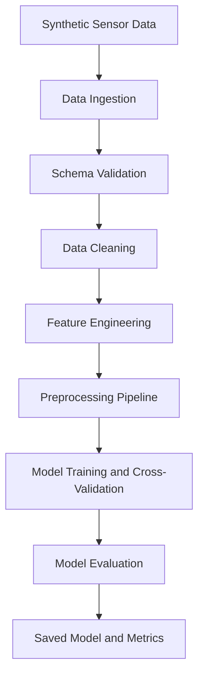

# AQI Sentinel
### Smart-City Air Quality Prediction | End-to-End Machine Learning Pipeline

**Turning noisy environmental data into actionable air-quality insights.**

AQI Sentinel is an end-to-end machine learning pipeline that simulates multi-station environmental readings, handles imperfect sensor data, engineers physically motivated features, and trains and evaluates an AQI prediction model.

Built with Python and scikit-learn, the project focuses on more than model accuracy: **data quality, leakage-safe preprocessing, modular architecture, and reproducibility** are first-class design goals.

[View the Results Dashboard](AQI%20Prediction%20%E2%80%93%20Results%20Dashboard.html)

---

## At a Glance

| Component | Details |
|:--|:--|
| **Domain** | Environmental Data Science and Smart Cities |
| **Task** | Air Quality Index (AQI) regression |
| **Language** | Python |
| **ML Framework** | scikit-learn |
| **Data Engineering** | Validation, cleaning, and feature engineering |
| **Evaluation** | Cross-validation and regression metrics |
| **Pipeline** | Data generation → Ingestion → Cleaning → Training → Evaluation |

## Why This Project?

Real-world sensor data is rarely clean. Readings can be missing, corrupted, duplicated, or affected by extreme values.

AQI Sentinel addresses these challenges through a modular pipeline designed to:

- **Simulate imperfect sensor data** with synthetic environmental readings, missing values, and injected faults.
- **Validate and clean incoming data** through schema checks, type coercion, duplicate handling, and physical-bound validation.
- **Engineer domain-informed features** using temporal cycles, pollutant ratios, and environmental interactions.
- **Prevent data leakage** by fitting learned preprocessing operations only on training data.
- **Evaluate models systematically** using cross-validation and regression metrics.
- **Persist trained artifacts** for repeatable evaluation and downstream inference.

## The Pipeline



### Pipeline Stages

| Stage | Responsibility |
|:--|:--|
| **01. Generation** | Generate synthetic environmental observations with injected faults and missing values. |
| **02. Ingestion** | Load data, validate its schema, and coerce appropriate data types. |
| **03. Cleaning** | Handle duplicates, invalid measurements, missing labels, and extreme observations. |
| **04. Feature Engineering** | Extract temporal cycles and physically motivated interaction features. |
| **05. Preprocessing** | Apply outlier capping, imputation, scaling, and categorical encoding as configured. |
| **06. Modeling** | Train candidate regressors and evaluate them using cross-validation. |
| **07. Evaluation** | Calculate regression metrics and save evaluation results. |
| **08. Persistence** | Store the fitted model and metrics for later use. |

## Tech Stack

- **Python** for implementation and orchestration
- **NumPy and Pandas** for numerical computation and tabular data processing
- **scikit-learn** for preprocessing, feature transformations, cross-validation, and regression
- **Joblib** for model persistence
- **CSV and JSON** for data and metrics storage

See [`requirements.txt`](requirements.txt) for the project's dependencies.

## Project Structure

```text
aqi-pipeline/
├── main.py                 # End-to-end pipeline orchestrator
├── data_generator.py       # Synthetic environmental data generation
├── requirements.txt        # Python dependencies
├── README.md
├── .gitignore
├── raw_data.csv            # Generated input dataset
├── artifacts/
│   ├── aqi_model.joblib    # Serialized model after execution
│   └── metrics.json        # Evaluation metrics after execution
└── src/
    ├── __init__.py
    ├── config.py           # Centralized configuration
    ├── ingestion.py        # Data loading and schema validation
    ├── cleaning.py         # Cleaning, outlier handling, and reports
    ├── features.py         # Feature engineering and preprocessing
    ├── modeling.py         # Training, evaluation, and persistence
    ├── exceptions.py       # Custom pipeline exceptions
    └── logger.py           # Logging utilities
```

## Getting Started

### Prerequisites

- Python 3.10 or newer recommended
- Git
- A terminal with `pip` available

### 1. Clone the Repository

```bash
git clone https://github.com/ojas-v/aqi-pipeline.git
cd aqi-pipeline
```

### 2. Create a Virtual Environment

**Windows PowerShell**

```powershell
python -m venv .venv
.\.venv\Scripts\Activate.ps1
```

**Linux or macOS**

```bash
python3 -m venv .venv
source .venv/bin/activate
```

### 3. Install Dependencies

```bash
python -m pip install --upgrade pip
pip install -r requirements.txt
```

### 4. Run the Pipeline

```bash
python main.py
```

The orchestrator executes the configured workflow and generates the corresponding outputs.

## Outputs

| Artifact | Purpose |
|:--|:--|
| `raw_data.csv` | Synthetic environmental dataset |
| `artifacts/aqi_model.joblib` | Persisted trained model |
| `artifacts/metrics.json` | Evaluation metrics |

Output availability depends on successful pipeline execution and the configured artifact paths.

## Engineering Decisions

### 1. Leakage-Safe Preprocessing

Stateless data-quality rules can be applied before splitting when they do not estimate information from the dataset. Operations that learn statistics, such as median imputation, IQR capping, scaling, and encoding, belong inside the scikit-learn pipeline so they are fitted on training data only.

### 2. Different Faults Require Different Treatments

- Physically impossible sensor readings are treated as invalid or missing.
- Extreme but plausible observations are handled through outlier treatment.
- Missing target values are dropped rather than imputed with fabricated labels.

### 3. Cyclical Temporal Features

Hour-of-day and day-of-year features can be encoded with sine and cosine transformations, preserving the circular relationship between values such as 23:00 and 00:00.

### 4. Physically Motivated Feature Engineering

Environmental interactions, particulate matter ratios, and stagnation-related features can represent relationships that raw sensor measurements may not capture independently.

### 5. Modular Model Development

Separating configuration, feature engineering, training, evaluation, and persistence makes the pipeline easier to debug, test, and extend.

### 6. Cross-Validation of the Complete Estimator

Cross-validating the preprocessing and modeling pipeline together ensures that learned transformations are refitted within each training fold, reducing leakage during model selection.

## Limitations and Scientific Validity

A high evaluation score does not automatically imply that a model can predict future real-world air quality.

- **Synthetic data:** The model learns patterns generated by the simulator. Performance on real monitoring-station data remains unverified.
- **Target construction:** If AQI is derived from PM2.5 or PM10 measurements included among the input features, the task can become partly circular. A high R² may reflect the target-generation formula rather than generalizable predictive power.
- **Nowcasting vs. forecasting:** Predicting AQI from contemporaneous pollutant measurements is different from predicting AQI hours or days ahead.
- **Temporal validation:** Random cross-validation does not establish future forecasting performance. A forecasting extension should use chronological splits or `TimeSeriesSplit`, with features constructed without future information.
- **Generalization:** Performance across different cities, seasons, sensor types, and pollution regimes must be validated using appropriate real-world datasets.

These limitations define the next stage of development rather than being capabilities the current implementation has already demonstrated.

## Roadmap

- [ ] Add automated unit tests for ingestion, cleaning, and feature engineering.
- [ ] Benchmark multiple regression models with consistent validation.
- [ ] Add hyperparameter optimization using `RandomizedSearchCV`.
- [ ] Integrate real-world air-quality monitoring datasets.
- [ ] Build a forecasting variant using lagged and rolling features.
- [ ] Add model explainability with SHAP.
- [ ] Monitor data drift and prediction quality over time.
- [ ] Develop a deployable inference API and interactive dashboard.

## Author

**Ojas Vaidya**

ECE Student | Communication Systems | Machine Learning and Signal Processing

- GitHub: [ojas-v](https://github.com/ojas-v)
- LinkedIn: [Ojas Vaidya](https://www.linkedin.com/in/ojas-vaidya-833665365/)

---

*Built to explore the intersection of environmental sensing, data engineering, and machine learning.*
